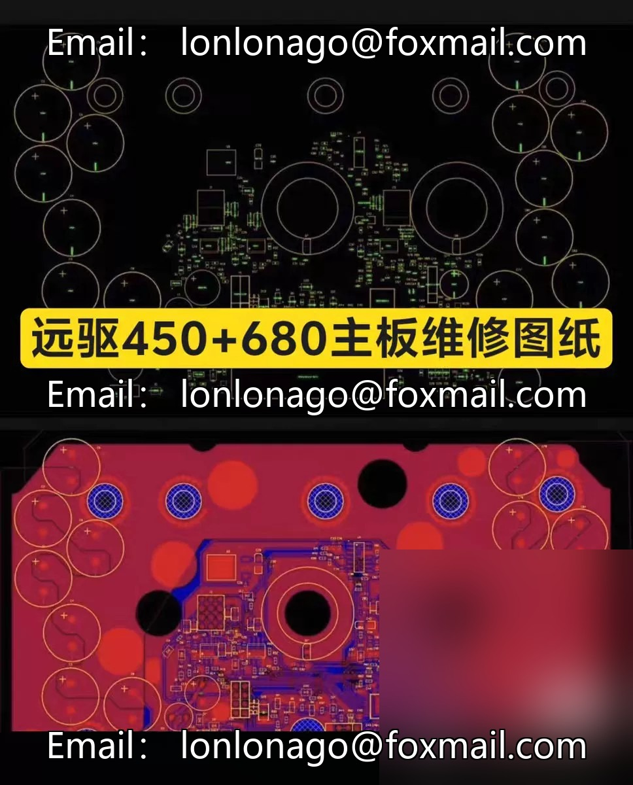
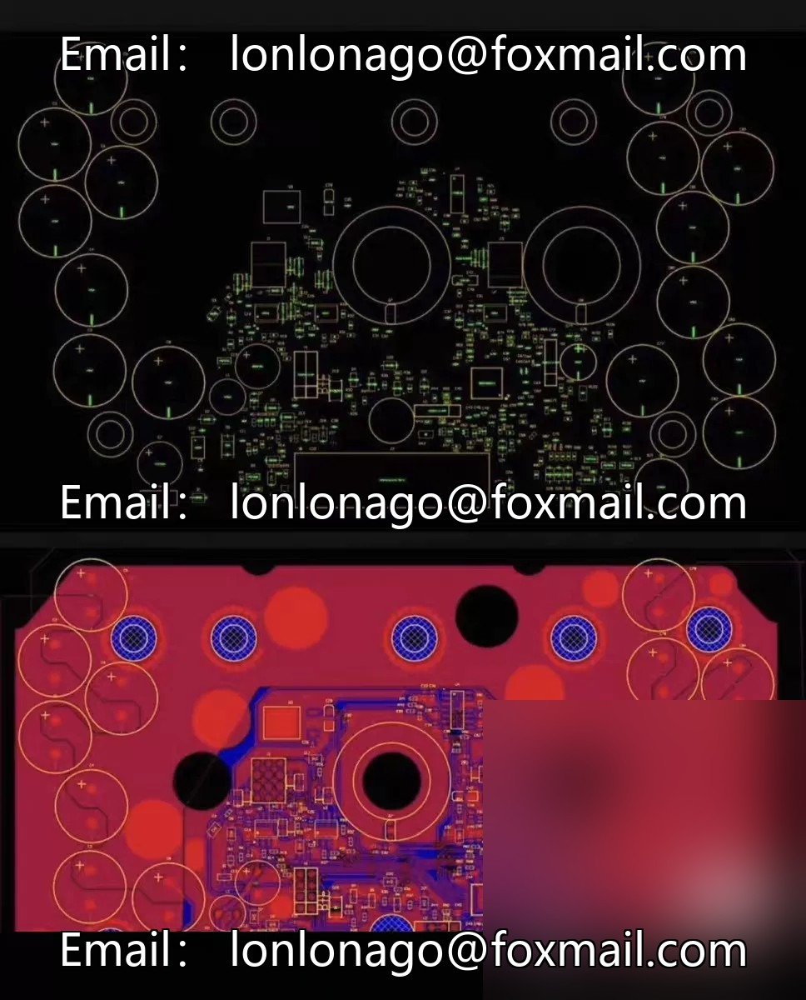
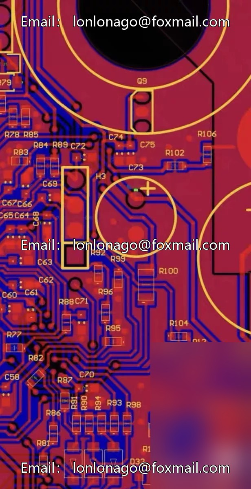
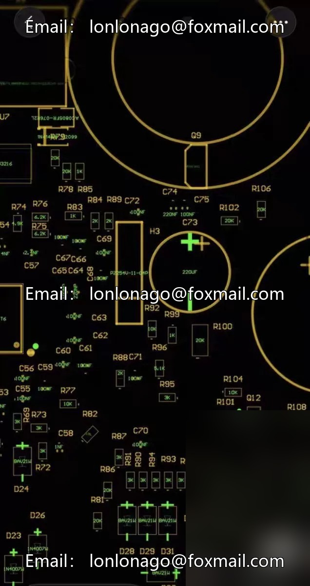

# Far-reaching 450+680 motherboard repair schematics, for routine maintenance only, prohibited for commercial use.

## Body

Far-reaching 450+680 motherboard repair schematics, for routine maintenance only, prohibited for commercial use.

Professional repair of all series of faults in the long-range drive controller, including firmware flashing, prolonged beeping, explosion of tubes, bridge current, underbridge current, Bluetooth connection, missing phase, throttle, Hall sensor, voltage drop, etc. Supports upgrade modification of tubes, unbinding, brick rescue, and wiring post repairs.

Sold, no technical support provided! Need it? Consult us if you have questions.

Need other model drawings or have questions.

## Images

## Payment

Here is a pay link on Stripe ( https://buy.stripe.com/3cs8yP7sY87d0vu9AB ). Please contact me lonlonago@foxmail.com after funding $89, and I will send you a complete data files , thank you!

